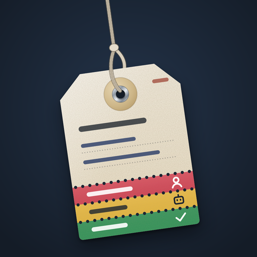
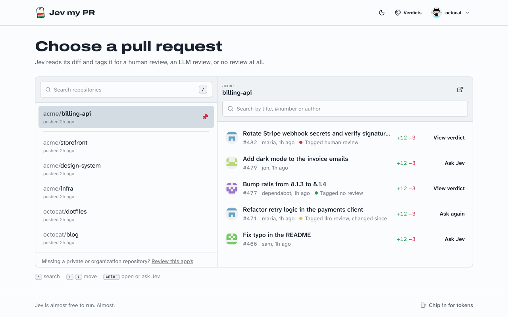
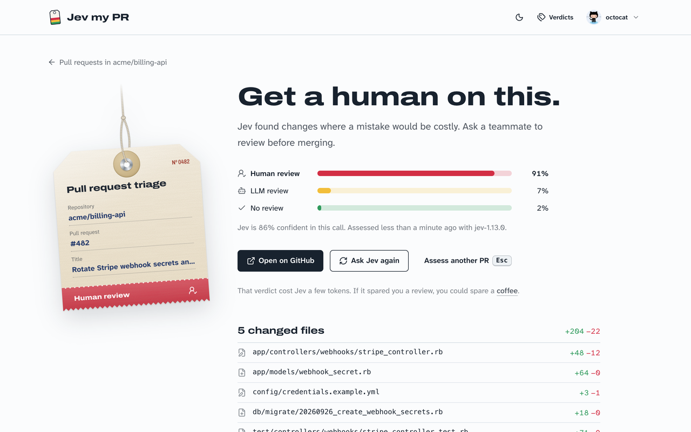
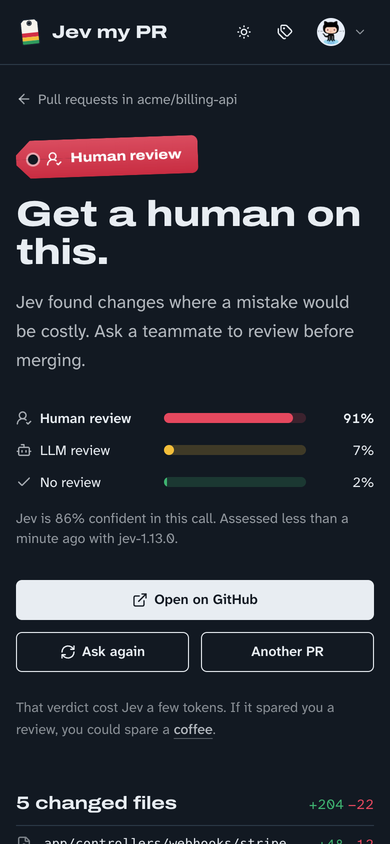

<p align="center">
  
</p>

<h1 align="center">Jev my PR</h1>

<p align="center"><strong>Does this pull request need a human?</strong><br>
Pick a PR from your GitHub repositories and Jev reads the diff and tags it:<br>
<em>human review</em>, <em>an LLM review is enough</em>, or <em>no review needed</em>.</p>

<p align="center"><strong><a href="https://jevmypr.romerramos.me">Try it at jevmypr.romerramos.me</a></strong> · free, sign in with GitHub</p>

<p align="center">
  
</p>

## How it works

1. **Sign in with GitHub** and pick one of your repositories (pin the ones you use most).
2. **Pick an open pull request.** Jev my PR sends its title, description, file list and diff to
   [Jev](https://typesafe.ai), a small classification model, with one question:
   *does this PR need a review from a human?*
3. **Read the verdict.** Jev answers with one of three options and how sure it is:

| Verdict | Meaning |
|---|---|
| 🟥 **Human review** | Risky or complex changes (security, auth, payments, data migrations, architecture). A teammate should review. |
| 🟨 **LLM review** | Real but low-risk changes (small features, refactors, tests). An automated LLM review should catch what matters. |
| 🟩 **No review** | Trivial changes (typos, docs, formatting, version bumps). |

Verdicts belong to the GitHub repository, identified by its stable GitHub ID. Everyone signed in with current
GitHub access to that repository can read them in the picker, recent results and verdict history. Opening a PR
at an already-assessed head commit reuses the saved result for free, even if a teammate requested it. **Ask Jev
again** deliberately creates a fresh verdict and uses the requesting person's allowance.

Pins, votes and reasons are personal. Sharing a verdict never shares or overwrites a teammate's feedback.
Opening a verdict, voting on it and asking Jev check access live with the viewer's GitHub token. Lists of saved
verdicts trust the viewer's GitHub repository list, cached for up to 5 minutes, so access removed on GitHub can
take that long to disappear from them; **Refresh** (or **Check again**) re-reads it at once. Pins and earlier access
never grant access. Open pull requests are cached for a minute, and their diff stats per commit.

Jev also tags each changed file, in the same request: it reads the pull request once and answers the question for
the whole PR and for every file in parallel. The verdict page shows each file's tag next to it, so you know where a
reviewer should look first. Files without a text diff (such as images) don't get a tag.

<p align="center">
  
</p>

<p align="center">
  
</p>

## Your data

Jev my PR only uses your data to answer the question above.

- **GitHub:** it asks for the `read:user` and `repo` scopes. `repo` is the only way GitHub offers to read private
  repositories; the app only ever *reads* (repositories, pull requests, files and diffs) and never writes.
- **Sent to Jev (typesafe.ai):** for the pull request you pick: repository name, title, description (first
  5,000 characters), author login, branch names, line counts, file list and the diff
  (whole file patches, up to 100 KB).
- **Stored:** your GitHub id, login, name, avatar URL and account creation date; your GitHub token, **encrypted**
  with Active Record encryption; sign-in sessions (IP address and browser); repository-owned verdicts (GitHub
  repository ID/name, PR title, URL, author, head commit, file metadata, result and each file's verdict), shared
  too-big marks, request/token usage, your private vote and optional reason, and your pinned repositories.
  Patches are sent to Jev but are not stored. The GitHub PR author is repository metadata, not account attribution.
- **Diffs sent to the [open API](#open-api):** what the caller sends (repository name, title, description, branch
  names, file list and patches) goes to Jev the same way. Kept for 30 days and then deleted: the diff's SHA-256
  hash, its title, line counts, file names and statuses, the verdicts, and a random 24-character token for a
  future link to it; plus anonymous token usage. Not stored: patches, the description, branch and repository
  names, or any account. IP addresses aren't stored either: each request keeps a keyed hash of the caller's IP
  address for 2 days, for the daily limit below, and the address itself only keys a one-minute rate-limit counter.
  These verdicts belong to no repository or user, so they never show up in the app's lists or verdict pages.
- **Who can read it:** repository verdicts and PR/file metadata are shared with people whose own GitHub token
  currently has repository access. Your profile, token, sessions, pins, votes and reasons are not shared with them.
- **Not done:** no analytics, no trackers, no third-party scripts or fonts, nothing sold. The only other
  thing your browser loads is GitHub avatars, from GitHub.
- **Delete my data:** removes your account/profile, encrypted token, every session, pins, private votes/reasons,
  private legacy snapshots and legacy too-big marks, and all links identifying you as a requester. **Shared
  repository verdicts, their GitHub PR/file metadata and shared too-big marks remain** for currently authorized
  teammates, without a link to your account. Anonymous request/token usage remains so deletion does not reset the
  app's spend. This does not erase the shared artifacts themselves. You can also revoke the app under
  GitHub → Settings → Applications.

## Fair use limits

Jev my PR is free and runs on a small monthly budget, so there are limits (see
[`app/models/jev_allowance.rb`](app/models/jev_allowance.rb)):

- **30 new Jev calls per user per week** (about 6 per workday). Each verdict includes its files. Re-reading
  anyone's saved verdict and reopening a PR at an already-assessed head commit is free, before allowance checks.
  Explicit reanalysis uses the actual requester's allowance. A GitHub failure before Jev is called does not.
- **5 new-analysis requests per minute** per user; reading or reusing a result does not use this limit.
- GitHub accounts **younger than 30 days** can look around but can't ask Jev (keeps bots out).
- New verdicts **pause for everyone** once the month's estimated Jev spend reaches the budget, until the 1st.
- The [open API](#open-api) has its own, tighter limits, per IP address since it needs no sign-in:
  - **1 call every 2 minutes**, counting every call.
  - **10 new verdicts in any 24 hours.** A diff that already has a verdict gets it again without using this.
  - **A quarter of the monthly budget.** Once the API has spent it, the API pauses until the 1st; signed-in use
    carries on.
  - Request bodies over 2 MB are refused before they're read.

## Open API

Other tools can ask Jev about any diff, with no sign-in, cookie or API key: `POST /api/verdicts` with a JSON
body.

```sh
curl -X POST https://jevmypr.romerramos.me/api/verdicts -H "Content-Type: application/json" -d '{
  "repository": "acme/web",
  "title": "Fix typo",
  "description": "teh → the",
  "base_branch": "main",
  "head_branch": "typo",
  "files": [
    { "filename": "README.md", "status": "modified", "patch": "@@ -1 +1 @@\n-teh\n+the" }
  ]
}'
```

Only `files` is required (1 to 3,000). Each file takes `filename`, and optionally `previous_filename`, `status`
(`added`, `removed`, `modified`, `renamed`, … as on GitHub; default `modified`), `additions`, `deletions` (counted
from the patch when left out) and `patch`: that file's hunks, as GitHub shows them, without the `diff --git`, `---`
and `+++` lines. Patches can add up to 1 MB, but Jev reads whole patches up to 100 KB, in order.

```json
{
  "verdict": "none",
  "confidence": 0.8,
  "files": [
    { "filename": "README.md", "verdict": "none" },
    { "filename": "logo.png", "verdict": null, "skipped": "no_patch" }
  ],
  "diff_truncated": false,
  "url": null
}
```

`verdict` is `human`, `llm` or `none`. A file without a verdict says why in `skipped`: `no_patch`, `too_large`
(left out of the 100 KB), `too_many` (Jev answers for the first 100 files) or `no_answer`. `diff_truncated` is
true when patches were left out. `url` will link to a verdict page; it is `null` for now. The same diff sent again
(same files and patches) returns the saved verdict for 30 days without asking Jev.

Errors come as `{ "error": "<code>", "message": "..." }`:

| Status | `error` | When |
|---|---|---|
| 400 | `invalid_json` | The body isn't JSON. |
| 422 | `invalid_diff` | The diff isn't valid; `details` lists every problem. |
| 413 | `body_too_large` | The request body is over 2 MB. |
| 413 | `too_large` | The diff is too big for Jev to read in one go. |
| 409 | `in_progress` | The same diff is already being assessed. See `Retry-After`. |
| 429 | `rate_limited` | More than 1 call in 2 minutes from this IP address. See `Retry-After`. |
| 429 | `not_allowed` | This IP address has used its new verdicts for today. See `Retry-After`. |
| 503 | `budget_paused` | This month's budget, or the API's share of it, is spent. `Retry-After` points at the 1st. |
| 502 | `jev_unavailable` | Jev couldn't answer. |

## Run it yourself

You need Ruby (see [`.ruby-version`](.ruby-version)), SQLite, a GitHub account and a
[TypeSafe](https://typesafe.ai) API key.

1. **Create a GitHub OAuth App** at [github.com/settings/developers](https://github.com/settings/developers)
   (an *OAuth App*, not a *GitHub App*) with the callback URL `http://localhost:3000/auth/github/callback`.
   Suggested name, description and logo are in [`design/github`](design/github/README.md).
2. **Add your secrets** with `bin/rails credentials:edit`, following
   [`config/credentials.example.yml`](config/credentials.example.yml). Generate the encryption keys with
   `bin/rails db:encryption:init`. Environment variables work too:

   | Credential | Environment variable |
   |---|---|
   | `github.client_id` | `GITHUB_CLIENT_ID` |
   | `github.client_secret` | `GITHUB_CLIENT_SECRET` |
   | `typesafe.api_key` | `TYPESAFE_API_KEY` |
   | `active_record_encryption.primary_key` | `ACTIVE_RECORD_ENCRYPTION_PRIMARY_KEY` |
   | `active_record_encryption.deterministic_key` | `ACTIVE_RECORD_ENCRYPTION_DETERMINISTIC_KEY` |
   | `active_record_encryption.key_derivation_salt` | `ACTIVE_RECORD_ENCRYPTION_KEY_DERIVATION_SALT` |

3. **Start it:**

   ```sh
   bin/setup   # installs gems, prepares the database and starts the app on http://localhost:3000
   bin/dev     # later runs
   ```

### Tests

```sh
bin/rails test          # models, controllers, adapters (GitHub and Jev calls are stubbed)
bin/rails test:system   # the full flow in headless Chrome
bin/rubocop && bin/brakeman
```

### Upgrading to shared repository verdicts

Back up your database, then run the normal `bin/rails db:migrate` before starting the upgraded app. No new
secrets, external migration calls or repository membership backfill are needed.

Development preview repositories use reserved negative IDs, separate from GitHub's positive IDs. Preview and
live sessions cannot authorize, rename or reuse each other's shared results, even in the same development database.

Existing snapshots and oversized marks lack a verified GitHub repository ID. They remain **private legacy
data**, owned by the original user, and are never automatically bound by repository name or reused as shared
analysis. The owner can still read legacy snapshots, see their migrated votes and edit feedback after a fresh
GitHub name lookup confirms access; teammates cannot read legacy direct IDs or feedback. New analyses use a
live, stable repository ID and do not publish old snapshots. Deleting the owner's account erases private legacy
history, while its anonymous token usage remains in the spend ledger.

The migration preserves snapshot IDs, PR/file metadata, votes/reasons/times and historical usage. It separates
personal feedback from verdicts and copies usage into an independent ledger. The old schema cannot represent
shared results or separate votes, so rollback requires restoring the pre-upgrade backup, not `db:rollback`.

Simultaneous ordinary requests for the same repository/PR/head commit reserve one analysis in a short database
transaction. Others are asked to reopen the PR in a moment, without calling Jev or consuming their allowance.
Network calls run outside the transaction. Abandoned reservations expire after 30 minutes; an explicit fresh
analysis is still a deliberate separate call. Unchanged oversized results are remembered for the repository.

### Deploying

It's a standard Rails 8 app with a `Dockerfile` and a [Kamal](https://kamal-deploy.org) config in
`config/deploy.yml`. In production, set `SECRET_KEY_BASE` and the variables above (or `RAILS_MASTER_KEY` with your
own credentials), and use a cache store for rate limiting (the Rails 8 default, Solid Cache, works).

## Releases

Releases follow [semantic versioning](https://semver.org): the current version is in [`VERSION`](VERSION), shown
next to the logo, and each release is a `vX.Y.Z` tag with notes on the
[releases page](https://github.com/romerramos/jevmypr/releases). `bin/release` cuts one and `bin/update` deploys it on a server
that runs the app from a git checkout (backup, update, restart, health check and automatic rollback, set up in
[`config/server.example.yml`](config/server.example.yml)); [AGENTS.md](AGENTS.md) describes both, for people and
coding agents.

## Built with

Rails 8, Hotwire (Turbo and Stimulus), SQLite, Tailwind CSS 4 with [daisyUI](https://daisyui.com),
[Lucide](https://lucide.dev) icons, [Pagy](https://ddnexus.github.io/pagy/) and OmniAuth. Fonts:
[Archivo](https://github.com/Omnibus-Type/Archivo) and
[Atkinson Hyperlegible Next](https://github.com/googlefonts/atkinson-hyperlegible-next), self-hosted.

## Contributing

Issues and pull requests are welcome. Please run the tests, RuboCop and Brakeman before opening a PR;
[AGENTS.md](AGENTS.md) has the project conventions.
To report a security problem, see [SECURITY.md](SECURITY.md).

## Support

Jev is almost free to run. Almost. If Jev my PR spared you a review or two, you can
[chip in for tokens](https://buymeacoffee.com/romerramos). ☕

## License

[MIT](LICENSE) © Romer Ramos. The bundled fonts are under the SIL Open Font License
(see [`app/assets/fonts`](app/assets/fonts)); daisyUI is MIT.
